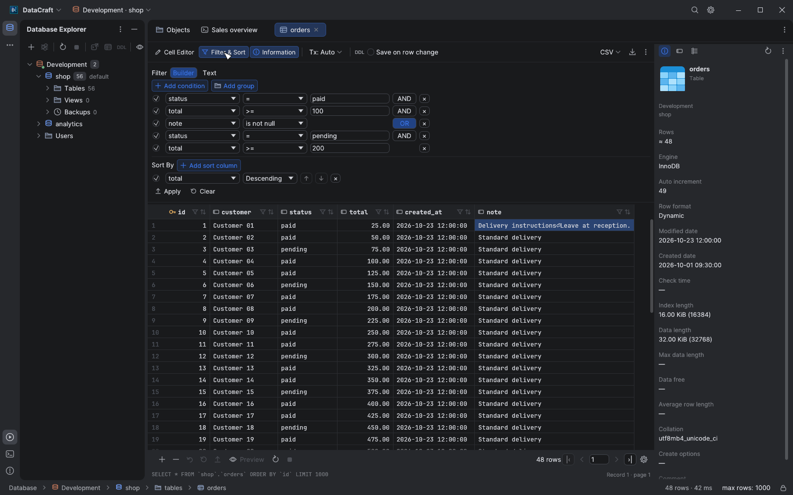

  

<h1 align="center">DataCraft</h1>

  <strong>A native workspace for your databases.</strong> 
  Explore schemas, write queries and edit data in a focused desktop app built with Rust and egui. 
  macOS · Windows

  
  
  

  <a href="#download">Download</a> ·
  <a href="#highlights">Highlights</a> ·
  <a href="#supported-databases">Databases</a> ·
  <a href="#build-from-source">Build</a> ·
  <a href="#documentation">Documentation</a> ·
  <a href="#contributing">Contribute</a>

  <picture>
    <source media="(prefers-color-scheme: light)" srcset="docs/screenshots/readme/workspace-light.png">
    
  </picture>
   
  The table workspace, with navigation, editing tools and object information in one view. Light and dark themes are included.

Screenshots show the current source build on Windows with synthetic data. Every capture includes the complete application window and its custom header. Published releases may not yet include all changes shown here.

## Highlights

| Explore | Query and edit | Manage |
| --- | --- | --- |
| Browse databases in a compact list or grid. Inspect tables, columns and records without losing your place. | Write SQL with completion, navigate cells with the keyboard and review pending changes before submitting them. | Organize objects with folders and colors, move data between databases and run engine-specific backups. |

DataCraft starts on an empty **Objects** workspace. Saved query and table tabs remain available, and selecting a database opens its objects. Layout choices and **Save on row change** are remembered between sessions.

## Browse with context

The Database Explorer loads databases and schemas as you expand them. Object folders start collapsed, so large connections stay manageable.

Use **List** for catalog statistics or **Grid** for compact names arranged from top to bottom. Select an object to inspect its columns, storage information and engine-provided timestamps. Unavailable metadata is shown explicitly; exact row counts are fetched on request.

<table>
  <tr>
    <td width="50%"></td>
    <td width="50%"></td>
  </tr>
  <tr>
    <td align="center">List: compare catalog information.</td>
    <td align="center">Grid: scan names and organize related objects.</td>
  </tr>
</table>

- Select multiple objects with Shift, Ctrl/Command or a mouse rectangle. Drag them into local groups and assign colors to tables or folders.
- Use **Find in Schema…** to search accessible SQL tables across a selected database or schema.
- Close tabs individually, to either side, or in bulk from their context menu.

Groups and colors are local preferences; they do not change the database. See [object browsing](docs/object-browser.md) and [navigation, search and organization](docs/navigation-search.md).

## Write queries, keep the results close

SQL consoles provide syntax highlighting, completion, formatting, find and replace, query history, execution plans and cancellation. Run the current statement, a selection or the entire script. SQL Server scripts support <code>GO</code> batches.

  
   
  A query and its results, with the active database visible in the workspace.

Redis/Valkey and MongoDB consoles use their own commands, including <code>HGETALL user:1</code> and <code>db.orders.find({total: {$gte: 100}})</code>. Their result grids are read-only.

## Edit data with clear feedback

Navigate with arrow keys and Tab; the grid scrolls to keep the active cell visible. Extend selections with Shift, select a column by its name, paste clipboard matrices or fill selected cells with one value.

Pending edits have a distinct highlight. Updates, inserted rows and deletions can be reviewed as generated SQL and submitted in one transaction. **Save on row change** is optional and disabled by default; for a bulk edit, it submits when you leave the edited row range.

  
   
  Edit longer values below the grid and inspect the selected record alongside it.

The cell editor supports multiline text and a UTF-8 hex view. The inspector switches between table information, the selected column and the current record. Read-only connections disable editing and DDL.

[Table editing and shortcuts →](docs/table-editor.md)

## Build filters before applying them

Combine enabled conditions in nested **AND/OR** groups, choose comparison or text operators, and add ordered sort columns. Switch to **Text** mode for custom <code>WHERE</code> and <code>ORDER BY</code> expressions. Editing the draft does not run a query; **Apply** reloads the data.

  
   
  A filter draft and sort rule, ready to apply.

Ctrl+F, or Command+F on macOS, searches the currently loaded cells. **Find in Schema…** searches the database instead. See [search behavior and scope](docs/navigation-search.md).

## Move, export and back up data

- **Import and export:** import CSV/TSV into tables; export results as CSV, TSV, JSON, SQL inserts or Markdown.
- **Copy tables:** transfer selected data between connections, databases or schemas, translate column types between engines and optionally include related rows through foreign keys.
- **Mask values:** apply consistent per-column masking during table copies or exports.
- **Manage objects:** create and modify tables and views, review generated DDL, and manage MySQL/MariaDB users or PostgreSQL roles and privileges.
- **Back up databases:** open **Back up database…** from the Database Explorer, review engine-specific options and choose a destination. Jobs run in the background with cancellation and local history.

  
   
  Backup settings in context. Available modes and destination rules depend on the engine.

PostgreSQL, MySQL and MariaDB backups require their native dump utilities. SQLite uses its online backup API. SQL Server, Oracle and Snowflake use server-side backup or export facilities with engine-specific privileges and destinations. See [backup modes, prerequisites and limitations](docs/database-backups.md).

## Supported databases

| Database | Connection and workspace |
| --- | --- |
| PostgreSQL | SQL console, data editor, schemas, views, roles and logical backups |
| MySQL / MariaDB | SQL console, data editor, views, users and logical backups |
| SQL Server | SQL console with <code>GO</code> batches, data editor, object management and native backups |
| Oracle | SQL console, data editor, object management and Data Pump exports; requires Oracle Instant Client |
| Snowflake | Native REST connection without Java; password, key-pair, OAuth or programmatic access token authentication |
| SQLite | Local database files, SQL console, data editor and online backups |
| ClickHouse | Native TCP protocol (port 9000), SQL console and data editor for inserts only (updates and deletes are asynchronous mutations, run them from the console) |
| Redis / Valkey | Native commands, keys grouped by prefix, type/TTL information and read-only result grids |
| MongoDB | <code>mongosh</code>-style commands, collection browsing and read-only result grids |

Support varies by engine, server version and account privileges. [Oracle Instant Client](https://www.oracle.com/database/technologies/instant-client.html) must be installed separately for Oracle connections.

## Designed for the desktop

- **macOS and Windows:** native macOS menus and window controls; a unified application header on Windows.
- **Light and dark themes:** adjustable interface zoom and editor font size.
- **Eight interface languages:** English, Spanish, French, Brazilian Portuguese, German, Polish, Simplified Chinese and Japanese. Follow the system language or choose one in Settings.
- **OS credential storage:** saved passwords use macOS Keychain or Windows Credential Manager, rather than the connections file.

Built with Rust, egui/wgpu and Tokio. Database work runs through background workers to keep the interface responsive.

## Download

Get packaged builds from the official [GitHub Releases](https://github.com/javy-fernandez/datacraft/releases).

| Platform | Package | Install |
| --- | --- | --- |
| macOS 11+ · Apple Silicon and Intel | <code>DataCraft-&lt;version&gt;-universal.dmg</code> | Open the disk image and move DataCraft to Applications. |
| Windows 10/11 · x64 | <code>DataCraft-&lt;version&gt;-windows-x64.zip</code> | Extract the archive and run <code>DataCraft.exe</code>. |
| Windows on ARM · ARM64 | <code>DataCraft-&lt;version&gt;-windows-arm64.zip</code> | Extract the archive and run <code>DataCraft.exe</code>. |

The macOS app is not notarized and Windows executables are unsigned, so the operating system may show a first-launch warning. Check the release notes for the build you download.

## Build from source

Use a Rust toolchain with support for the 2024 edition and the native build tools for your platform.

~~~sh
git clone https://github.com/javy-fernandez/datacraft.git
cd datacraft
cargo run --locked
~~~

For an optimized Windows executable:

~~~sh
cargo build --locked --release
~~~

The output is <code>target/release/datacraft.exe</code>. Native MSVC builds require the Visual Studio C++ build tools and Windows SDK, including the resource compiler used to embed the application icon.

On Linux, the same commands build a native Wayland/X11 app rendered with Vulkan. The build links the system SQLite and D-Bus libraries, so install their development packages first:

~~~sh
sudo dnf install gcc pkgconf-pkg-config sqlite-devel dbus-devel      # Fedora
sudo apt install build-essential pkg-config libsqlite3-dev libdbus-1-dev  # Debian / Ubuntu
~~~

At runtime it needs a Vulkan driver and a Secret Service provider, such as GNOME Keyring or KWallet, to store saved passwords.

On macOS:

~~~sh
scripts/bundle.sh --install
scripts/bundle.sh --universal --dmg
~~~

The universal build requires both Apple Silicon and Intel Rust targets. The bundle script uses <code>DATACRAFT_SIGN_IDENTITY</code>, or a certificate named <code>DataCraft</code>, when available; otherwise it uses ad hoc signing. A stable signing identity helps preserve Keychain access between builds.

Cross-compile Windows builds from macOS

For x64, install the GNU Windows target and MinGW-w64:

~~~sh
rustup target add x86_64-pc-windows-gnu
brew install mingw-w64
cargo build --locked --release --target x86_64-pc-windows-gnu
~~~

For ARM64, use cargo-xwin with LLVM and LLD:

~~~sh
rustup target add aarch64-pc-windows-msvc
cargo install cargo-xwin
brew install llvm lld
cargo xwin build --locked --release --target aarch64-pc-windows-msvc
~~~

cargo-xwin downloads the Windows SDK and requires acceptance of Microsoft's license.

## Documentation

| Guide | Contents |
| --- | --- |
| [Database workspace](docs/database-workspace.md) | Inspectors, cell editor, structured filters and pagination |
| [Object browser](docs/object-browser.md) | List/grid layouts, object metadata and row-count semantics |
| [Table editor](docs/table-editor.md) | Keyboard navigation, selections, bulk edits and optional automatic saving |
| [Navigation and search](docs/navigation-search.md) | Table search, schema search, local groups/colors and tab management |
| [Database backups](docs/database-backups.md) | Engine support, native utilities, destinations and cancellation |
| [Application icon](docs/application-icon.md) | Shared artwork and native Windows/macOS icon assets |
| [Window header](docs/window-chrome.md) | Platform-specific window controls and validation notes |
| [Screenshots](docs/screenshots/readme/README.md) | Reproduce the full-window documentation captures |

## Contributing

Bug reports, focused pull requests and translation improvements are welcome. Include your operating system, database engine/version and steps to reproduce the issue. Use synthetic data in screenshots and examples.

Run the relevant checks before submitting a change:

~~~sh
cargo test --locked --all-targets
cargo clippy --locked --all-targets -- -D warnings
cargo fmt --all -- --check
~~~

Live integration tests require separately configured database services. Run only the relevant ignored tests against a disposable environment; do not run the entire ignored suite against personal or production databases.

Translations live in <code>locales/&lt;code&gt;.json</code>, keyed by their English labels. The MySQL/MariaDB and PostgreSQL user editors were inspired by [DBCraft](https://github.com/DarkSoe/DBCraft) by DarkSoe.

## License

DataCraft is available under [MIT](LICENSE-MIT) or [Apache-2.0](LICENSE-APACHE), at your option. Bundled fonts retain their own SIL Open Font License 1.1; see the [font notices](assets/fonts/README.md).
