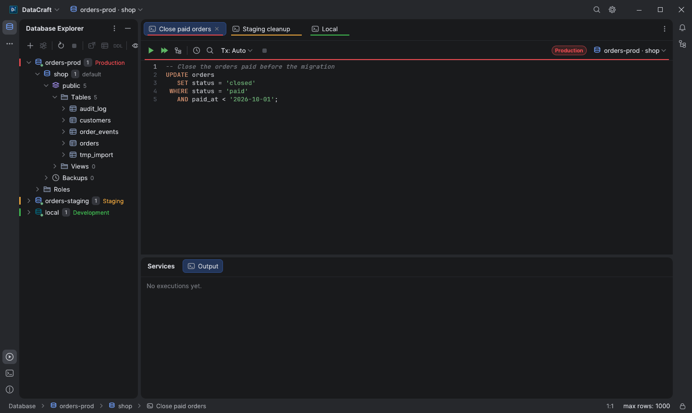
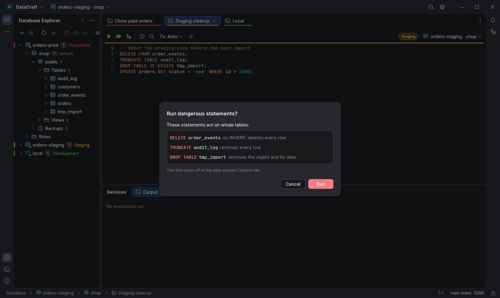
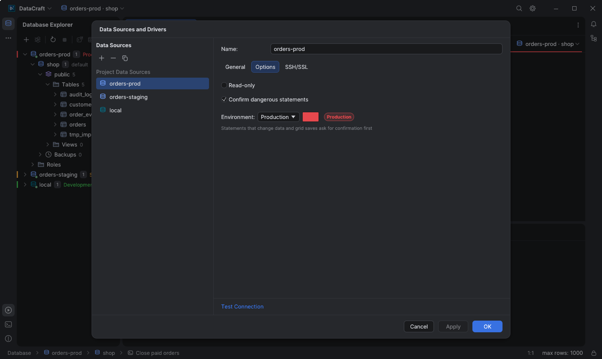
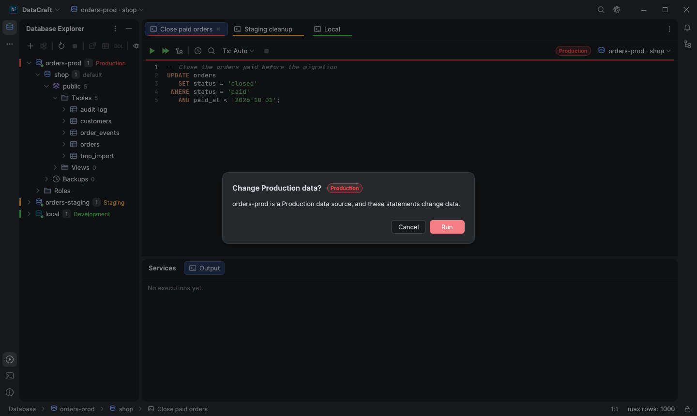
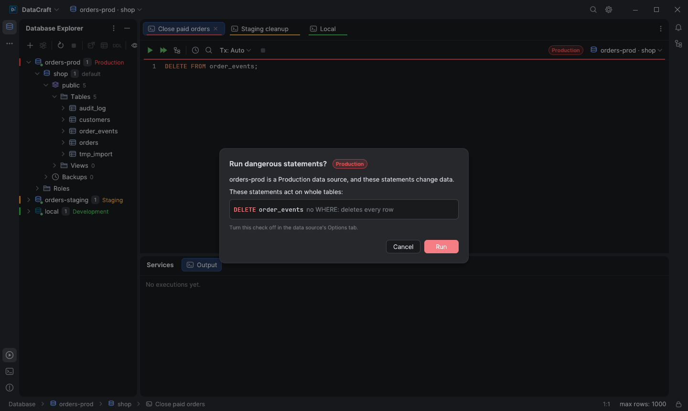
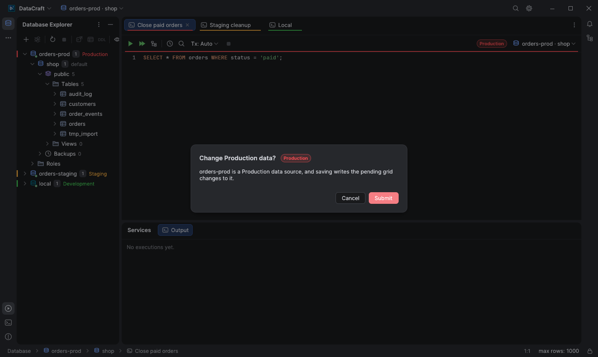

# Dangerous statements and connection environments

Two safeguards keep a console from changing more than you meant to: the SQL
console asks before statements that act on whole tables, and data sources can
be marked as Development, Staging or Production, with Production asking before
anything changes its data.

## Dangerous statement guard

Before the console runs a statement or a script, it looks for:

| Statement | Why it asks |
| --- | --- |
| `UPDATE` without `WHERE` | changes every row of the table |
| `DELETE` without `WHERE` | deletes every row of the table |
| `TRUNCATE` | removes every row |
| `DROP` (tables, views, databases, schemas, functions…) | removes the object and its data |

The prompt lists each of them with its target; **Run** sends exactly the
statements you ran, **Cancel** (or Esc) runs nothing.

The check reads the SQL with the same lexer the console uses to split and
highlight statements, for the data source's engine:

- Strings, quoted identifiers and comments (`--`, `/* */`, MySQL `#`, Snowflake
  `//`, PostgreSQL dollar quotes, Oracle `q'[…]'`) are never mistaken for
  statements, and a `WHERE` inside them does not count.
- Only a `WHERE` of the statement itself counts: one inside a subquery
  (`UPDATE t SET a = (SELECT … WHERE …)`) or a `USING (…)` list does not filter
  the rows that change.
- CTEs: `WITH … UPDATE` / `WITH … DELETE` are checked like the plain
  statements, and PostgreSQL's data-modifying CTEs
  (`WITH gone AS (DELETE FROM t RETURNING *) …`) too.
- PostgreSQL `UPDATE … FROM` and `DELETE … USING` without `WHERE` still change
  every row; `ONLY t` and `WHERE CURRENT OF` are understood.
- MySQL and MariaDB: like `--safe-updates`, a `LIMIT` bounds the statement, so
  `DELETE FROM logs ORDER BY id LIMIT 1000` runs without asking. Multi-table
  `DELETE a, b FROM …` and `UPDATE a JOIN b … SET` name every target.
- SQL Server: `DELETE FROM x FROM y JOIN …` targets `x`; `TOP (n)` bounds the
  statement (`TOP (n) PERCENT` does not). Statements written without `;` are
  told apart (`UPDATE … WHERE …` followed by `DELETE FROM b` on the next line),
  as are `IF`, `BEGIN TRAN` / `TRY` blocks, `CASE` expressions and table hints.
- Routine bodies only run when called, so they are not looked into:
  `CREATE FUNCTION` / `PROCEDURE` / `TRIGGER` / `RULE` / `EVENT` in every
  engine, PostgreSQL `BEGIN ATOMIC` bodies, SQLite triggers and SQL Server
  batches that create or alter a routine. Anonymous blocks run now, so their
  statements are checked (`BEGIN … END` in PL/SQL, MariaDB `BEGIN NOT ATOMIC`,
  T-SQL blocks).

The guard covers PostgreSQL, MySQL, MariaDB, SQLite, SQL Server, Oracle,
Snowflake and ClickHouse. Turn it off per data source with **Confirm dangerous
statements** in the **Options** tab of the data source dialog; it is on for new
data sources and for those saved by earlier versions.

## Connection environment

The **Options** tab also sets the data source's **Environment**: None,
Development, Staging or Production. Each has a colour (green, amber and red),
which the colour button next to it can change; **Reset** goes back to the
environment's own.

A data source with an environment shows it:

- as a badge next to the console's data source selector, with a line in its
  colour under the console and data editor toolbars,
- as a line under every editor tab that uses it,
- as a coloured edge and label on its row in the Database Explorer.

## Production

On a Production data source, every run that changes data or structure asks
first, once per run, whatever the statements are. Reads (`SELECT`, `WITH`,
`SHOW`, `EXPLAIN`…) run at once; the same rule decides what a read-only data
source may run, in the engine's own language for Redis, MongoDB, InfluxDB and
Kusto too.

| Statements | A dangerous statement |
| --- | --- |
|  |  |

When a Production run also has dangerous statements, a single prompt names
both. Saving changes made in a result grid or the data editor (Submit,
⇧ / ⌘S or Save on row change) asks too, before anything is sent; Cancel keeps
the pending changes in the grid.

## Limitations

- The check reads SQL text. Statements built at run time (`EXECUTE IMMEDIATE`,
  `EXEC('…')`, PostgreSQL `DO $$ … $$` blocks) and procedures you call are not
  looked into; on Production they still ask, because they are not reads.
- A `WHERE` that matches every row (`WHERE 1 = 1`) counts as a filter, and
  `ALTER TABLE … DROP COLUMN` is not treated as a `DROP` statement.
- In SQL Server batches without `;`, a statement that follows a `CREATE`,
  `ALTER`, `MERGE` or `GRANT` is checked as part of it.
- Redis, MongoDB, InfluxDB and Kusto have no dangerous statement check
  (`FLUSHALL`, `deleteMany({})`…); the Production prompt covers them.
- Run SQL Script…, scheduled tasks and the explorer's own Drop / Truncate
  dialogs (which already ask) do not go through this prompt.
- On Production, session commands such as `SET`, `USE` or `BEGIN` count as
  changes and ask too.
