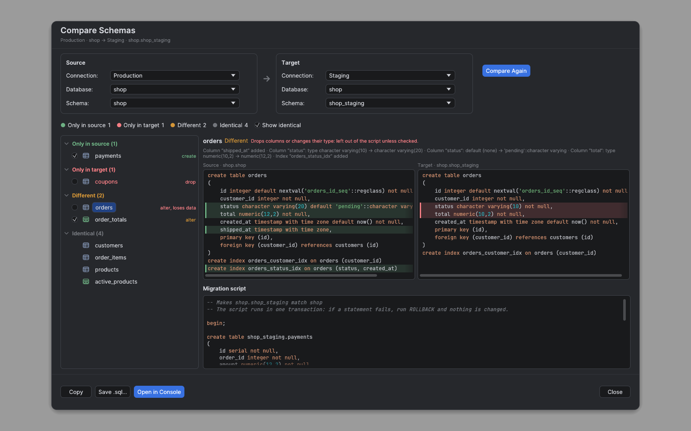

# Compare schemas

**Compare Schemas…** shows what differs between two schemas and writes the script that
makes the second one (the **target**) match the first one (the **source**). Both can be on
the same connection or on different ones, for example production and staging.

It is available on PostgreSQL, MySQL, MariaDB, SQL Server, Oracle and SQLite, from the
Database Explorer menu of a connection, a database or a schema. The place it is opened
from becomes the source; the target starts on another connection of the same engine when
there is one.

## Comparing

1. Pick the source and the target: connection, database and schema (MySQL, MariaDB and
   SQLite have one schema per database, chosen with it).
2. Click **Compare**. Both schemas are read in the background on sessions of their own;
   the dialog shows how many objects have been read, and **Cancel** stops the comparison,
   also while a connection is still being opened.
3. The objects are grouped by status:

| Status | Meaning | In the script |
| --- | --- | --- |
| Only in source | The target lacks it | Created (checked) |
| Only in target | The source lacks it | Dropped, only if you check it (it deletes its data) |
| Different | Both have it, with changes | Altered (checked), unless the change drops columns or changes their type (marked *alter, loses data*): then only if you check it |
| Identical | Nothing to do | Hidden unless **Show identical** is on |

Select an object to see what changed and both definitions side by side; the changed lines
are tinted (green on the source, red on the target). Uncheck an object to leave it out of
the script; the script is regenerated at once.

The result, its script and **Open in Console** always belong to the pair that was compared,
which the dialog's subtitle names. Changing a picker afterwards marks the result as out of
date: **Copy**, **Save .sql…** and **Open in Console** stay disabled until you compare
again.

What is compared:

- **Tables**: columns (added, dropped, type, nullability, default, identity /
  auto-increment), primary key, indexes and foreign keys (with their delete and update
  rules).
- **Views**: the definition text.

Trivial differences are ignored so that equal schemas show **No differences**: each side's
own schema name where it qualifies one of the compared tables, views, sequences or types,
letter case and blanks outside quoted text, names where the engine ignores case (SQLite,
MySQL, MariaDB, SQL Server), and equivalent type spellings (`int4` and `integer`, MySQL
`int(11)` and `int`). Column order is not compared.

Only those references move to the target schema in the script. String literals,
`alias.column` references (even when a table is named like its schema), and functions,
extension objects (`citext`, `uuid_generate_v4()`…) or tables of any other schema keep
their qualifier: they are shared, so `public.f()` stays `public.f()` when `public` is
compared with another schema.

Objects that can't be compared are listed above the result, and never count as "no
differences" (the dialog then says **No differences in the compared objects**): PostgreSQL
partitioned tables and their partitions, materialized views, foreign tables and extension
objects, Oracle materialized views, and SQLite virtual tables.

## The script

The script is never run by the dialog. **Copy** puts it on the clipboard, **Save .sql…**
writes it to a file and **Open in Console** opens it in a new console on the compared target
database, where you review it and run it yourself. On a read-only target the console still
opens, with a warning that it can't be run there. Run the script as a whole: on SQL Server
each statement is a batch of its own, ended by `GO`.

On PostgreSQL, SQLite and SQL Server the script runs in one transaction, so a failing
statement leaves the target as it was: PostgreSQL and SQLite wait for a `ROLLBACK` (SQLite:
also run the pragmas at the end of the script, which turned foreign key checks off before
the transaction began); SQL Server rolls back by itself (`XACT_ABORT`) and the following
batches don't run. MySQL, MariaDB and Oracle commit each DDL statement, so the statements
before a failing one stay applied.

Statements are ordered so that they can run top to bottom:

1. Foreign keys that are in the way: those on tables or columns that are dropped, on
   columns whose type changes, or on a primary key that changes. Those that should stay
   are added back at step 6.
2. Views to drop: dropped views; changed views SQLite can't replace; on PostgreSQL the
   changed views `CREATE OR REPLACE` can't handle (it only adds columns at the end), the
   views that use a column the script drops or retypes, and the views on those. They are
   created again at step 7, and the script lists them: grants, owner, comments and view
   options (`security_barrier`, `security_invoker`, check option) are lost. A view on a
   table the script drops is dropped with it and not created again, with a warning. Other
   changes (a new primary key, an index) leave the views alone.
3. Dropped tables.
4. New tables, with their primary key and indexes (PostgreSQL `serial` columns stay
   `serial`; other sequences are created first).
5. Changed tables, with the same statements as **Modify Table…**. SQLite can't alter most
   of a table in place: new nullable columns and index changes are made with `ALTER
   TABLE`, anything else rebuilds the table: a new table made with the source table's own
   `CREATE TABLE` statement (so its CHECK constraints, collations, generated columns,
   `WITHOUT ROWID` and `STRICT` come along), the rows copied, the old one dropped and the
   new one renamed. The script then starts with `pragma foreign_keys = off` and ends by
   restoring the session's settings, so it must run as a whole. A rebuild would drop the
   target table's triggers: such a table is marked **manual** (needs a manual migration),
   can't be checked, and is never scripted.
6. Foreign keys.
7. New and changed views, each after the views it uses (`CREATE OR REPLACE`, SQL Server
   `CREATE OR ALTER`, where the view isn't dropped first).

Changes that can lose data (dropped tables and columns, new types) are listed as comments
at the top, on every engine, as are the things the script can't do.

Comparing two different engines shows the differences but writes no script: types, keys
and SQL differ too much for one script. MySQL and MariaDB count as the same engine.

## Limitations

- Not compared: CHECK constraints, triggers, sequences on their own, user types (enums,
  domains), comments, collations, grants, procedures and functions, and the objects listed
  as not compared above.
- Expression and partial indexes are compared by name only and are not created by the
  script.
- Generated columns are written with their expression on PostgreSQL, MySQL, MariaDB and
  Oracle (`generated always as (…)`); only MySQL and MariaDB can change that expression in
  place. SQL Server computed columns are left out of the script, with a warning.
- SQLite tables are also compared by their CHECK constraints, collations, `ON CONFLICT`
  clauses, generated columns, `WITHOUT ROWID` and `STRICT`.
- SQL Server can't add or remove a column's identity in place: the script says so.
- Adding a `NOT NULL` column without a default fails on a table that has rows: the script
  warns about it.
- Snowflake and ClickHouse schemas can't be compared yet; NoSQL connections don't offer it.

The previews in [screenshots/schema-compare](screenshots/schema-compare/README.md) show the
dialog before comparing, and the result in the light theme.
