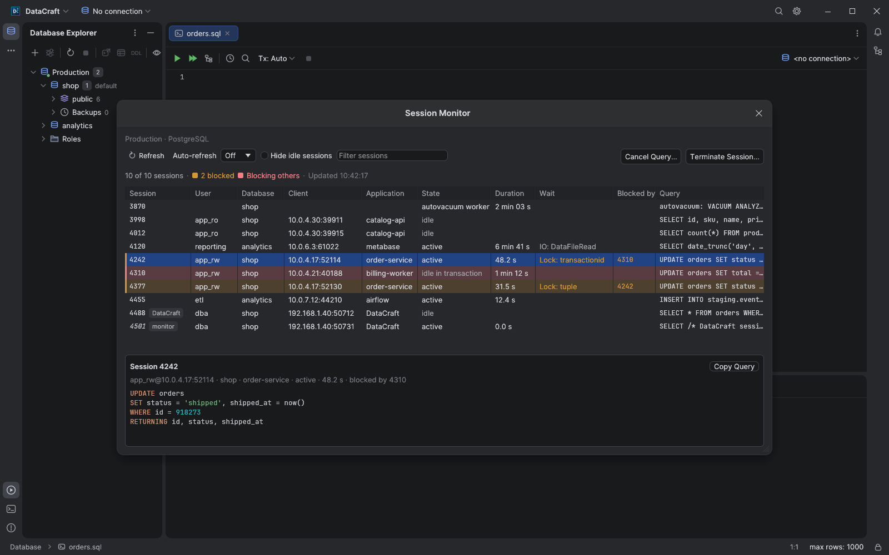
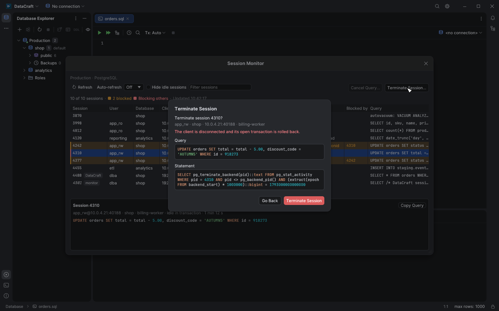

# Session Monitor

Right-click a connected PostgreSQL (10 or later), MySQL, MariaDB, SQL Server, Oracle or
ClickHouse connection in Database Explorer and choose **Session Monitor…**. The window lists the
server's sessions without blocking the rest of the app: consoles, the explorer and other
windows stay usable while it is open, and one monitor can be open per connection.

Each row shows the session id, user, database, client address, application, state,
how long the current query (or open transaction) has run, the wait event, the sessions
it is **blocked by**, and the query on one line. Hover the query for its full text, or
select the row to read it, highlighted, in the pane below the table, which has **Copy
Query**. The row's context menu has **Copy Query** and **Copy Session ID**.

Sessions waiting for another are tinted amber; the session at the head of a chain,
which others wait for and which waits for nobody, is tinted red. In the example, 4310
holds a row lock in an open transaction, 4242 waits for it and 4377 waits for 4242.
**Hide idle sessions** keeps blockers visible even when they are idle, and the text
filter matches any column. The monitor's own session is marked *monitor* and in italics;
other DataCraft sessions are marked *DataCraft* where the server reports the
application name (PostgreSQL, SQL Server, Oracle).

**Refresh** reads the list again; **Auto-refresh** repeats it every 2, 5 or 10 seconds
while the window is open. A refresh never starts while the previous one is still running.
While DataCraft is not the focused window, auto-refresh runs at most every 30 seconds (the
toolbar says so), and while it is minimized or covered it pauses: no frames are drawn and
no queries sent until it is shown again, in line with [low-power
rendering](low-power-rendering.md).

## Cancel and terminate

Select a session and choose **Cancel Query…** to stop its running statement (the
session and its transaction stay open) or **Terminate Session…** to disconnect it (its
open transaction is rolled back). Both ask for confirmation and show the statement that
will run. The monitor's own session can't be cancelled or terminated, and a session that
isn't running a query can't be cancelled. Actions only apply to a selected row that the
filter and **Hide idle sessions** still show. On read-only connections the list is
available, but both actions are disabled.

| Engine | Sessions from | Blocking | Cancel | Terminate |
| --- | --- | --- | --- | --- |
| PostgreSQL 10+ | `pg_stat_activity` (client backends and autovacuum workers) | `pg_blocking_pids`, for sessions waiting on a lock | `pg_cancel_backend`, only while the listed statement runs | `pg_terminate_backend` |
| MySQL / MariaDB | `information_schema.PROCESSLIST` | `sys.innodb_lock_waits`, or the InnoDB lock views, when available | `KILL QUERY` | `KILL` |
| SQL Server | `sys.dm_exec_sessions`, `sys.dm_exec_requests`, `sys.dm_exec_sql_text` | `blocking_session_id` | Not available | `KILL`, only if `login_time` is unchanged |
| Oracle | `v$session`, `v$sql` | `blocking_session` | `ALTER SYSTEM CANCEL SQL` with the SQL_ID (18c and later) | `ALTER SYSTEM KILL SESSION … IMMEDIATE` |
| ClickHouse | `system.processes` (running queries, not sessions) | — | `KILL QUERY` | Not available |

SQLite, Snowflake and the NoSQL engines have no Session Monitor. On PostgreSQL,
`pg_blocking_pids` briefly locks the lock manager's state, so it is only called for sessions
that wait on a lock; the sessions they wait for are highlighted from those lists.

Session ids are reused, so an action checks that the id still names the session that was
listed:

- PostgreSQL matches the backend start time in the same statement; if the process ended
  and its PID was reused, the action fails with "The session has already ended".
- SQL Server kills only if the SPID's `login_time` is unchanged, in the same batch;
  otherwise it reports that the session changed and asks for a refresh.
- MySQL and MariaDB don't reuse a thread id until the server restarts, so the list also
  records when the server started (from `Uptime`). Right before `KILL` the server start,
  the thread's account and its client (`USER`, `HOST` with the port, or `localhost` over a
  local socket) must still match. The check and `KILL` are two statements, so a thread
  that ends in between is not killed, but its id isn't reused either.
- Oracle identifies a session by SID and SERIAL#, and ClickHouse by query id.

Cancel Query also checks that the listed statement is still the one running, so a
confirmation left open can't cancel the session's next statement: PostgreSQL compares
`query_start` in the same statement, Oracle passes the SQL_ID to `CANCEL SQL`, and
ClickHouse cancels by query id. MySQL and MariaDB compare the statement's text right before
`KILL QUERY` and require it to have run at least as long as when listed (`TIME` is in whole
seconds, so the same text re-run within a second can't be told apart). Otherwise the action
fails with "The listed query has finished; the session is now running another statement".

An action is also refused when the list was read before the connection was closed or
opened again, and the window clears its list, selection and any open confirmation when
that happens. ClickHouse reports whether `KILL QUERY` reached the query: a query that
already finished, or that can't be cancelled, is reported as such.

Session ids always come from the listed rows and are checked to be numbers (a ClickHouse
query id is escaped, a SQL Server login time must have its exact format) before they are
written into a statement.

## Permissions and errors

The monitor uses a database session of its own, opened on first use and closed with the
window (or the connection, also when the window closes while it is still connecting), so it doesn't wait behind a running console query and never
cancels or takes down a console's session. Each request is limited to 15 seconds.

What the list contains depends on the account. PostgreSQL shows the details of other
roles' sessions only to superusers and members of `pg_read_all_stats`: without it those
sessions are listed with their id, user, database and application, their state reads
*insufficient privilege*, a note above the table counts them, and they can't be cancelled
or terminated from the monitor (their start time, which identifies them, is hidden too).
Cancelling or terminating another role's session needs `pg_signal_backend` or superuser.
MySQL lists other accounts' threads with `PROCESS` and kills them with `CONNECTION_ADMIN`
(or `SUPER`). SQL Server
needs `VIEW SERVER STATE` (`VIEW SERVER PERFORMANCE STATE` on 2022) to see other sessions
and `ALTER ANY CONNECTION` to kill them. Oracle needs access to `v$session` and `v$sql`
and `ALTER SYSTEM`. Errors, such as a missing permission, appear in the window above the
table; the last list stays visible. On MySQL and MariaDB a note explains when lock waits
can't be read.

Oracle reads `v$session` of the instance it is connected to: on RAC, sessions of the other
instances are not listed.

The PostgreSQL queries, cancel (including refusing it once the listed statement has
changed), terminate, the lock-wait display, the restricted rows of a role without
`pg_read_all_stats`, closing the monitor session and refusing an action after a reconnect
are covered by tests against a live PostgreSQL 16 server. The other engines'
queries and statements have unit tests but were not run against live servers.

References: [pg_stat_activity](https://www.postgresql.org/docs/current/monitoring-stats.html#MONITORING-PG-STAT-ACTIVITY-VIEW),
[PostgreSQL signaling functions](https://www.postgresql.org/docs/current/functions-admin.html#FUNCTIONS-ADMIN-SIGNAL),
[MySQL KILL](https://dev.mysql.com/doc/refman/8.4/en/kill.html),
[SQL Server KILL](https://learn.microsoft.com/en-us/sql/t-sql/language-elements/kill-transact-sql),
[Oracle ALTER SYSTEM](https://docs.oracle.com/en/database/oracle/oracle-database/19/sqlrf/ALTER-SYSTEM.html),
[ClickHouse KILL](https://clickhouse.com/docs/sql-reference/statements/kill).
