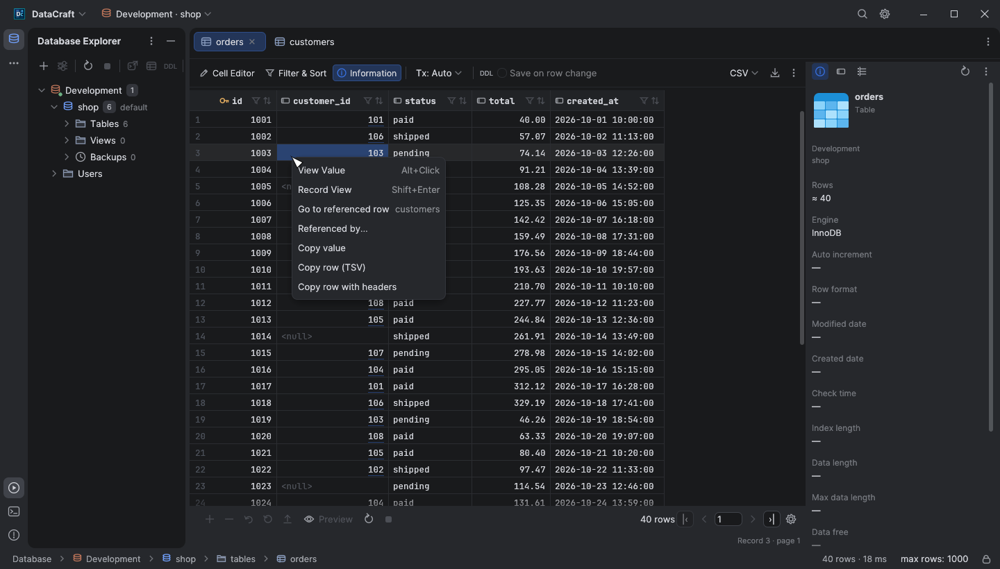
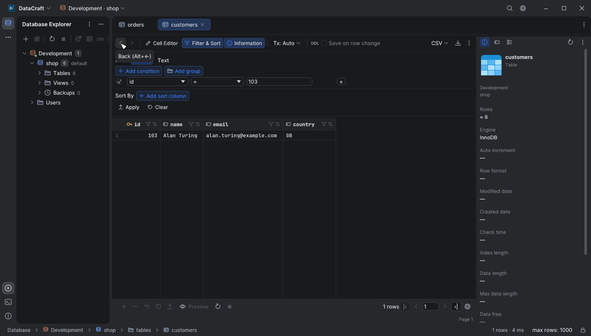
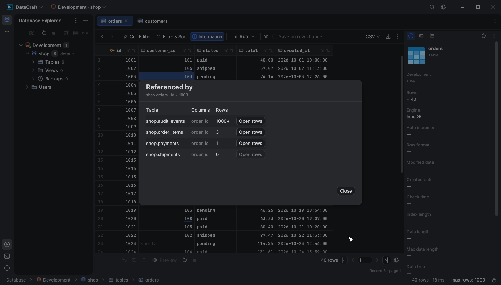

# Table editor keyboard navigation

Click a cell to select it. These shortcuts work when the grid is active; they do
not replace the SQL console editor's shortcuts. On macOS, use Command instead of
Ctrl for the combinations below.

| Keys | Action |
| --- | --- |
| Arrow keys | Select the adjacent cell |
| Enter, F2 or Ctrl+Enter | Edit the selected cell |
| Up / Down while editing | Finish the cell edit and select the previous / next row |
| Enter while editing | Finish the cell edit without moving the cursor |
| Tab / Shift+Tab | Move to the next / previous cell, wrapping between rows; during editing, edit the destination cell |
| Ctrl+Left / Right, Home / End | First / last column of the current row |
| Ctrl+Up / Down, Ctrl+Home / End | First / last loaded row in the current column |
| Page Up / Page Down | Move by approximately one visible page |
| Ctrl+Page Up / Page Down | First / last loaded row |
| Shift+Arrow | Extend a rectangular cell selection |
| Shift+click | Select the cell rectangle from the anchor |
| Ctrl+click | Add or remove individual cells from the selection; on an underlined foreign-key value, open the referenced row instead |
| Alt+click (⌥-click on macOS) | Show the cell's whole value in a popup below it (JSON indented); Esc or a click outside closes it. Double-clicking a cell that can't be edited, or View Value in the context menu, does the same |
| Drag with the mouse | Select a cell rectangle; dragging near an edge scrolls the grid |
| Click a column name | Select that entire column in the loaded, filtered grid |
| Ctrl+click a column name | Add or remove a column from the selection |
| Ctrl+A | Select all loaded cells |
| Ctrl+C / Ctrl+V | Copy the selection / paste a value or a TSV matrix |
| Delete | Set selected editable cells to NULL |
| Insert or Ctrl+N | Add a record |
| Ctrl+Delete | Mark the selected records for deletion |
| Ctrl+S | Submit pending changes |
| Escape | Discard the active record's pending changes; other records stay unchanged |
| Ctrl+Z | Undo a grid change (when the inline text editor is not active) |
| Alt+Left / Alt+Right (⌥←/⌥→ on macOS) | Go back / forward through foreign-key jumps (when no text field has focus) |

Left and right arrows inside the text editor move the text cursor. Navigation
respects the grid's current filters and sort order, includes newly added rows,
and stops at the edge of the loaded data. Binary and truncated values retain
their existing editing restrictions.

## Edit many cells together

Select a rectangle or column, then type a value or press F2/Enter to edit the
active cell. Finishing that edit fills all selected editable cells with the same
value. The whole fill is one Undo action. A single pasted value also fills the
selection; tab-separated clipboard data is pasted as a matrix. An oversized
matrix is rejected before any cells change.

Pending changes have an amber background. Selected changed cells keep that
background and add a blue outline, so selection cannot hide unsaved edits.

Column selection covers the loaded rows after the current filters, including
new rows, rather than every record in the database. Deleted rows, binary cells,
truncated values and rows without usable identifiers retain their protections.
The selection count is shown below the grid. Click an unselected cell to start a
new selection.

Column names select columns. The existing sort icon cycles ascending,
descending and unsorted order; the separate funnel icon opens the value filter.
Sorting or filtering commits an open editor into pending changes first.

## Follow foreign keys

Cells of declared foreign-key columns have a faint underline. Hold Ctrl (⌘ on
macOS) over one to show it as a link, then click to open the referenced row: the
parent table opens filtered to that key, in its existing tab when that tab has no
pending changes or running query, otherwise in a new tab. Right-click a cell for
**Go to referenced row** (one item per key using the column, with the parent table
shown on the right) and **Referenced by…**.

The jump uses the normal Filter & Sort builder: one `=` condition per key column,
so the filter can be edited, cleared or re-applied like any other. Values are
quoted for the connection's dialect; composite keys produce one condition per
column. A key with a NULL in any of its columns references nothing and is not a
link, and new (unsaved) rows have no links. Links follow the stored values, not
pending edits.

**Referenced by…** lists every foreign key that references the row's table, with
the number of rows referencing this row. Counts stop at 1000 (shown as `1000+`),
run on a separate session, time out after 30 seconds and are cancelled when the
dialog closes. **Open rows** opens the child table filtered to the referencing
rows. A key whose referenced columns are not all in the result is listed without
a count.

Every jump is recorded. The Back / Forward arrows at the start of the table
toolbar, or Alt+Left / Alt+Right, return to the previous table and filter; a
closed tab is reopened, and a tab with pending changes is only activated.

Keys are read per table, on a session of their own, the first time a result of
that table is shown, and cached until the schema is refreshed or the table tab is
reloaded. SQL console results get links only for a simple `SELECT` over one known
table, and only for columns that map unambiguously to that table's columns. The
feature is available on PostgreSQL, SQLite (`main` schema), SQL Server,
MySQL/MariaDB, Oracle and Snowflake; it is hidden for NoSQL engines and
ClickHouse. On Oracle, references from other owners are not listed, and on
MySQL/MariaDB only references from the same database.

## Optional save on row change

**Save on row change** is off by default. Its setting is remembered across app
restarts and shared by existing and newly opened table editors. SQL console
results retain explicit submission. Enable the checkbox
in the table toolbar to submit pending changes when leaving the edited rows
with the keyboard or mouse. The batch remains independent of the current cursor
selection and includes unchanged cells inside a bulk-edited range.

Submission uses the existing grid transaction: **all pending updates, inserts
and deletions are submitted together**, just as with Ctrl+S. Moving between
columns or rows inside the batch does not submit. For example, after filling one
column in rows 1–10, Enter keeps the cursor in place, and navigating any of those
rows across all columns keeps the batch pending. Entering row 11 submits it once.
Moving into a newly added row does not
submit it before its fields have been entered; finish entering the record and
move to an existing row, or press Ctrl+S.

The grid is unavailable during submission and its refresh so incoming results
cannot overwrite additional edits. A failed transaction leaves pending changes
in the grid for correction or retry. After a successful refresh, filters, sort
order and column widths remain; selection follows the destination record's
primary key when available, with a nearby row as fallback if it disappeared.

The option resets to off when the table tab is recreated. Read-only connections
cannot enable it. Use **Preview** to inspect pending SQL before submitting when
working in the default manual mode.

The navigation and row-leaving workflow follow the relational grid described in
the [Navicat 17 Windows manual](https://www.navicat.com/manual/pdf_manual/en/navicat_17/win_manual/navicat_en.pdf),
sections “Edit Records” and “Data Editor” keyboard shortcuts. DataCraft keeps its
existing transaction and SQL preview behavior.
