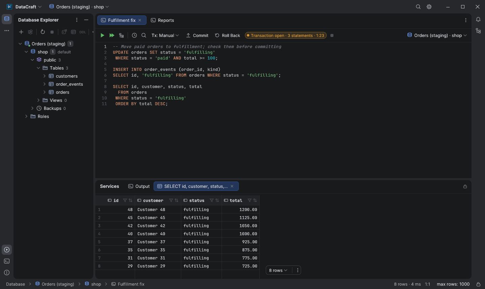
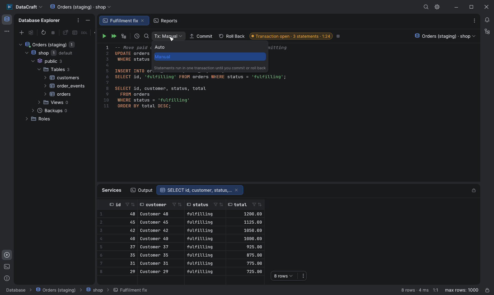
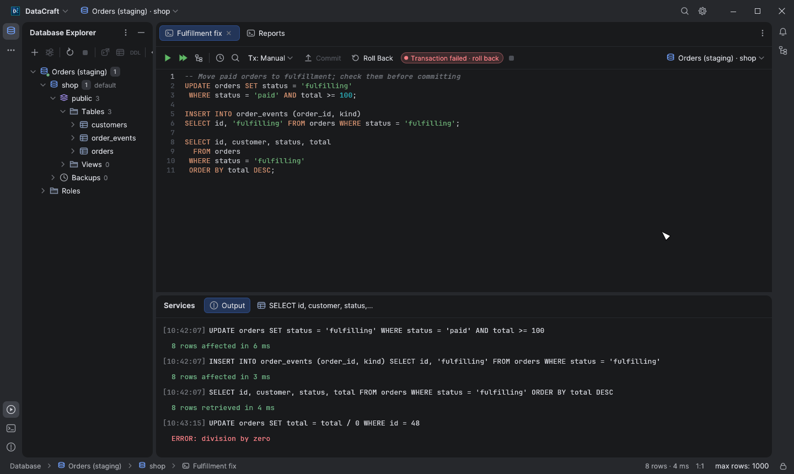
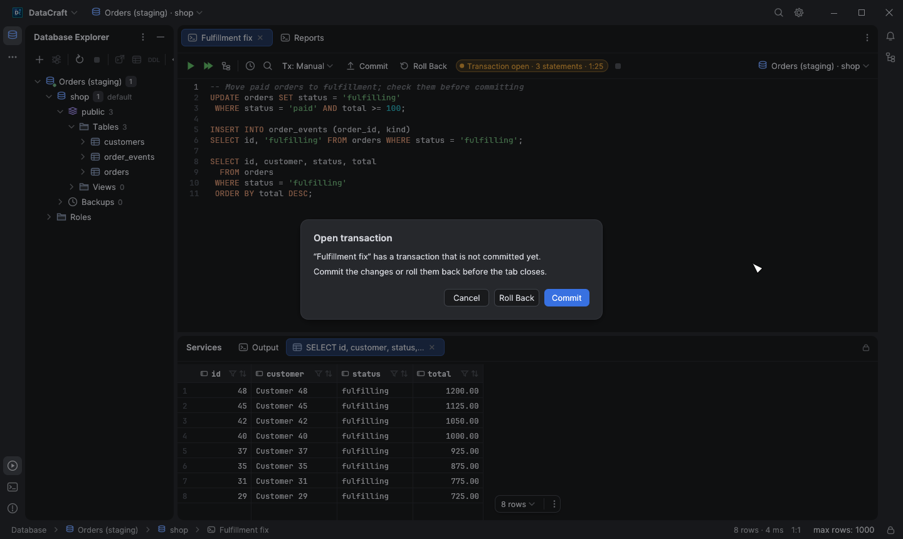
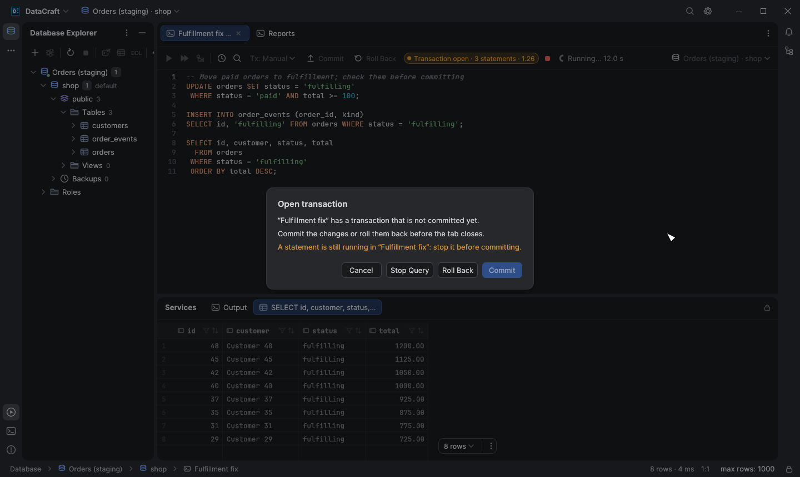

# Manual transactions in the SQL console

By default a console runs in **Auto** mode: each statement is committed as soon
as it runs. Switch the console toolbar's **Tx: Auto** menu to **Manual** to run
several statements, check their effect and then decide whether to keep them.

## How it works

- The first statement you run in Manual mode opens a transaction (`BEGIN`,
  `BEGIN TRANSACTION` or `START TRANSACTION`). Every later run joins the same
  transaction until you click **Commit** or **Roll Back** in the toolbar.
- The orange indicator shows that a transaction is open, how many statements ran
  in it and for how long. Commit and Roll Back report their result in **Output**
  like any other statement.
- A Manual console works on a database session of its own. Other consoles, the
  explorer and the data editor keep using the connection's shared session, so
  they don't see your uncommitted changes and their own statements are not run
  inside your transaction. They can still wait for rows or tables your
  transaction has locked, as with any other client.
- Nothing on that session commits by itself: MySQL and MariaDB run it with
  `autocommit = 0`, Snowflake with `AUTOCOMMIT = FALSE`, and Oracle without the
  per-statement commit of Auto mode. Turning autocommit back on in the console
  (`SET autocommit = 1`, `ALTER SESSION SET AUTOCOMMIT = TRUE`) commits what ran
  so far, and the console turns it off again.
- `COMMIT`, `ROLLBACK`, `BEGIN` or `START TRANSACTION` typed in the console are
  followed too. A `COMMIT` of a failed PostgreSQL transaction is answered by the
  server with a rollback, and the console says so. On MySQL and MariaDB a
  `BEGIN` / `START TRANSACTION` inside the open transaction commits it first.
- On MySQL, MariaDB, Oracle and Snowflake, DDL such as `CREATE TABLE` commits
  the work so far by itself (on MySQL and MariaDB also `LOCK TABLES`,
  `ANALYZE TABLE`, `FLUSH` and similar statements); the console says so and the
  next statements run in a new transaction. These engines commit before the DDL
  runs, so a DDL statement that fails has usually committed too: on MySQL and
  MariaDB always unless it didn't parse, while on Oracle and Snowflake the
  console says the work may have been committed. Oracle's `ALTER SESSION` /
  `ALTER SYSTEM` and Snowflake's `ALTER SESSION` keep the transaction open. When
  DataCraft can't tell whether the server ended the transaction (a procedure
  that commits), it keeps it marked open, so you are still asked before anything
  is closed.
- Statements the engine refuses inside a transaction (`VACUUM`,
  `CREATE DATABASE`, `CREATE INDEX CONCURRENTLY` on PostgreSQL; `VACUUM` and
  `ATTACH` on SQLite; `CREATE` / `ALTER DATABASE`, `BACKUP` and `RESTORE` on
  SQL Server) are not sent in Manual mode, so they don't abort the open
  transaction: switch the console to Auto to run them.
- Each run starts in the console's database, as in Auto mode: a `USE` typed in
  the console lasts for that run only.
- Result grids of a Manual console are read-only: change rows with SQL
  statements, so the changes stay in the transaction. Switching to Manual asks
  you to submit or discard pending grid changes first, and switching back to
  Auto makes the grids editable again.
- Read-only data sources can use Manual mode to read in one transaction. Writes
  are still refused, by the app and, where the engine supports it, by the
  server. On Oracle and SQL Server, locking reads (`SELECT … FOR UPDATE`, or
  reads under SQL Server's stricter isolation levels and hints) keep their locks
  until the transaction ends, so commit or roll back read-only transactions too.

| Mode menu | Failed transaction (PostgreSQL) |
| --- | --- |
|  |  |

## Errors inside a transaction

After an error, PostgreSQL aborts the whole transaction and refuses further
statements until it is rolled back. The indicator turns red and only **Roll
Back** is offered; `ROLLBACK TO SAVEPOINT` also recovers it. SQL Server reports
the same state for a doomed transaction. Other engines keep the transaction open
and only the failed statement has no effect; a MySQL or MariaDB deadlock
(error 1213) rolls back the whole transaction, which the console reports.

## Nothing is lost by accident

Closing the tab, switching the console's connection or database (in the
console or in the window header), switching back to Auto, disconnecting the
data source, saving changes to it in the connection dialog or deleting it, and
quitting DataCraft ask first while a transaction is open:

- **Commit** commits and then continues; if the commit fails nothing is closed
  and the error is shown.
- **Roll Back** rolls back and continues once the server has answered, or after
  a few seconds at most (closing the console's session then rolls back too).
- **Cancel** (or Esc) keeps the transaction open; it is always available, also
  while DataCraft waits for a commit or rollback.
- While a statement still runs in the console, Commit is unavailable: click
  **Stop Query** first, or wait for it to finish. Roll Back stops the statement
  itself. On engines without a native cancel (SQL Server) stopping closes the
  console's session, which rolls the transaction back; the prompt says so.
  This also applies while the first statement of a Manual console runs, since
  it may already have opened a transaction.

  

- A Commit or Roll Back already running from the toolbar is waited for before
  the tab closes or DataCraft quits, and its own result is reported. The
  toolbar's Stop button stops one that hangs, and after 30 seconds it is
  stopped anyway: the console's session is closed, which rolls back what was not
  committed (for a stopped commit, whether it committed is reported as unknown).

A Manual console's session is a connection of its own. If the connection's
shared session is lost (a cancelled query on an engine without native cancel,
a server that dropped it), the transaction stays open and continues after
DataCraft reconnects. It ends when the console's own session fails, when you
disconnect the data source, or when a Snowflake session expires and can't be
renewed (a new login would not continue the transaction); the console then says
the transaction was rolled back.

## Engines

Manual mode is available for PostgreSQL, SQLite, SQL Server, MySQL, MariaDB,
Oracle and Snowflake. ClickHouse, Redis, MongoDB, InfluxDB and Kusto have no
console transactions, so their Manual item is disabled. On SQLite an open write
transaction locks the database file for other writers until it ends.

Cancelling a running statement works in Manual mode too. On engines without a
native cancel (SQL Server, for example) the statement is abandoned by closing
the console's session, which also rolls back its transaction.

Screenshot regeneration is described in the [transactions screenshot notes](screenshots/transactions/README.md).
